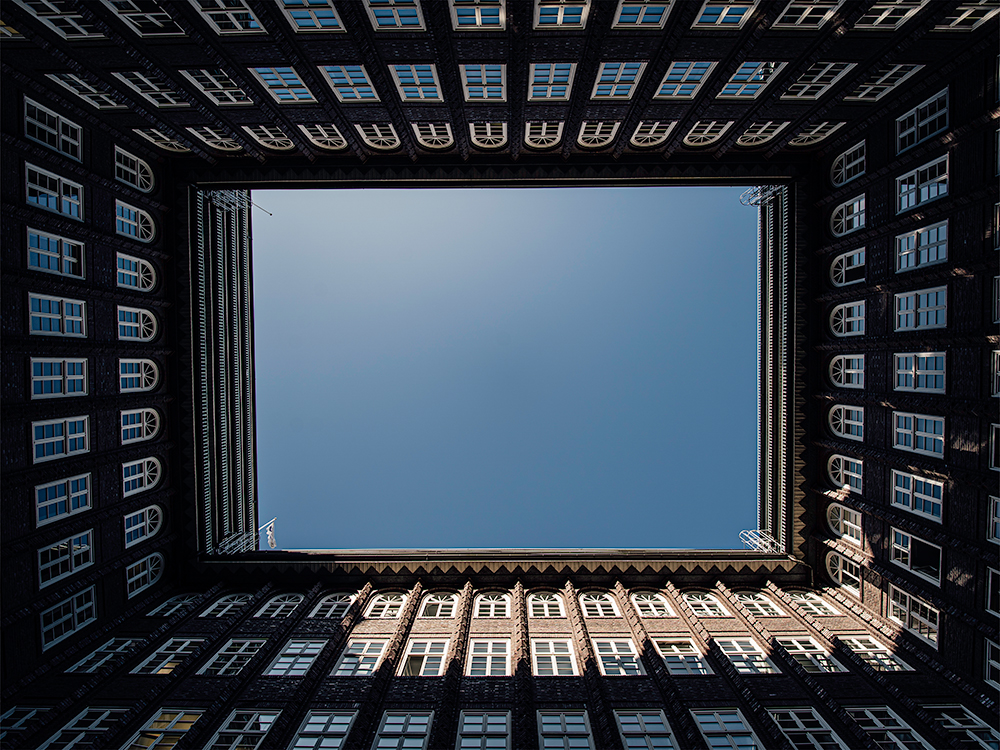
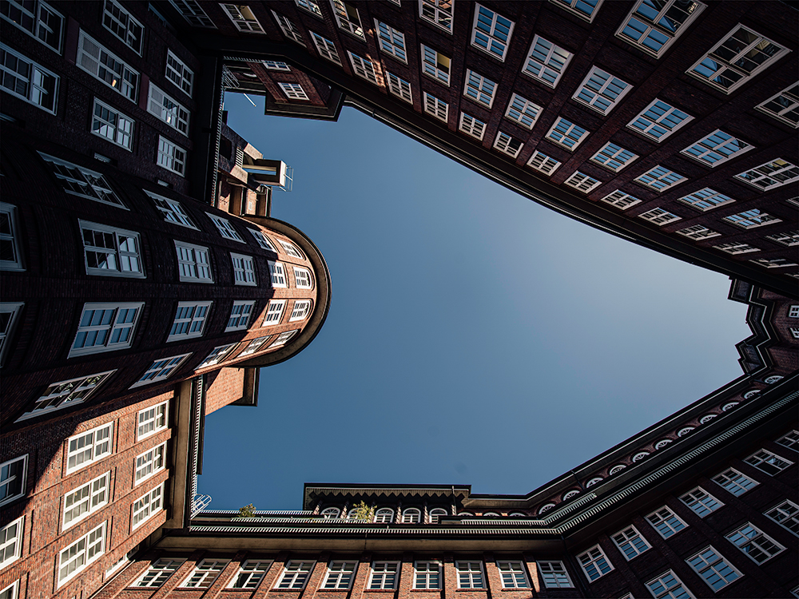
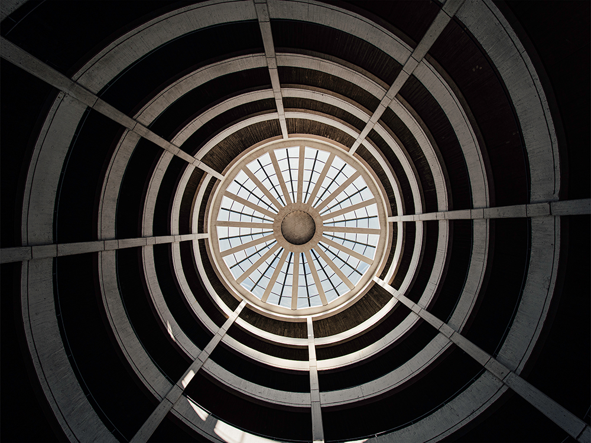
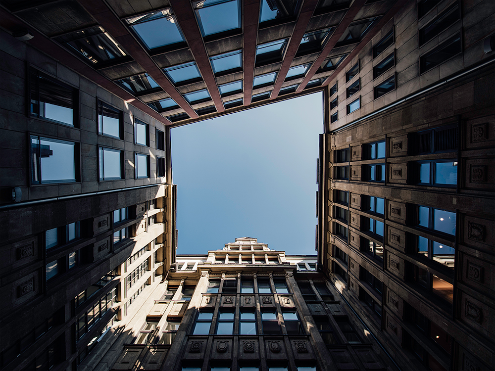
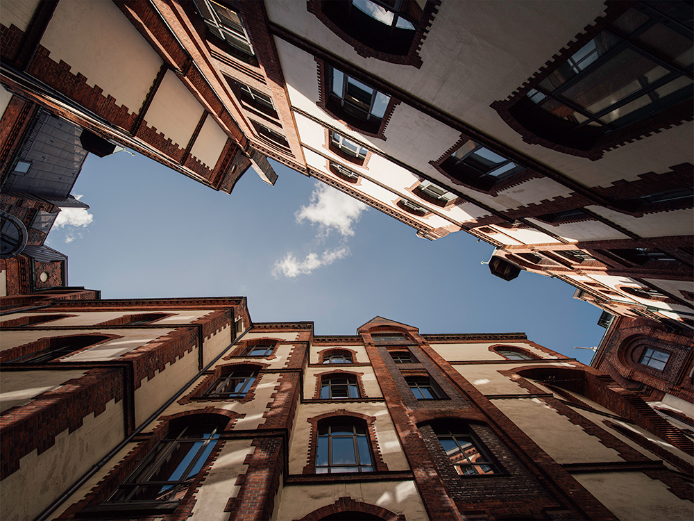
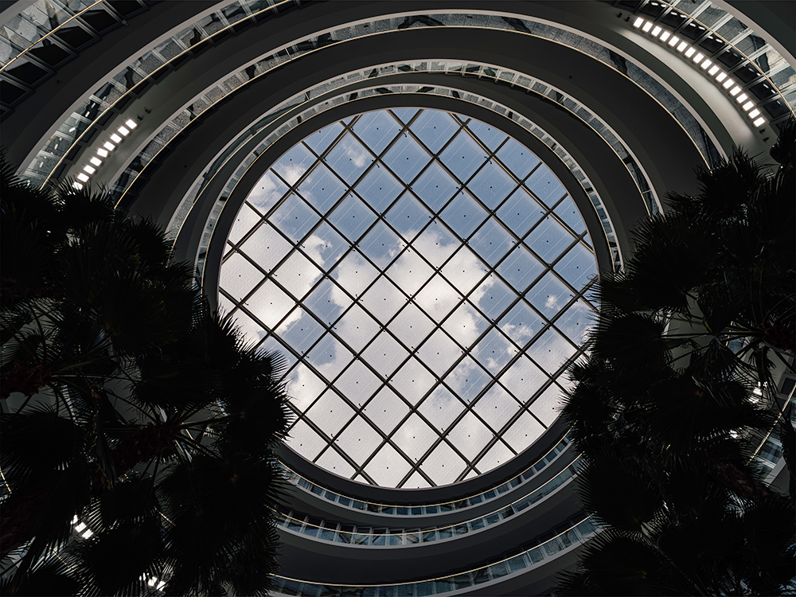
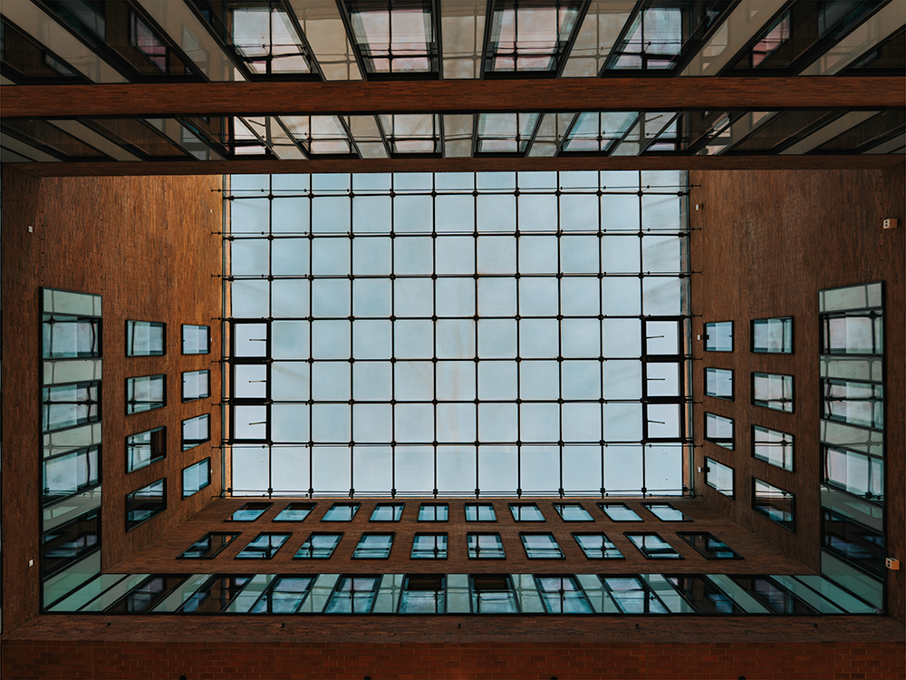

When walking through a city like Hamburg, it’s easy to keep your eyes fixed straight ahead—taking in the canals, the brick facades, and the bustle of the streets. 
But every now and then, stopping to look straight up reveals a completely different side of the city. 

From historic Kontorhäuser and hidden courtyards to unexpected places like a parking garage, tilting the camera upward turns everyday 
architecture into striking geometric patterns and frames of sky. 

Here are some of my favorite "looking up" shots from around Hamburg.

## Chilehaus

* **Location:** 53.54831656712141, 10.002992873392078

## Parking Garage at Reichenstraße

* **Location:** 53.54829677089464, 9.99641103870574

## Knochenhauertwiete

* **Location:** 53.550137391543444, 9.994913347973913

## Sandtorkai Hof

* **Location:** 53.544372015774854, 9.994877203007887

## Deutschlandhaus

* **Location:** 53.55628541445701, 9.987526606239266

## Große Elbstraße 47

* **Location:** 53.5441561171544, 9.947387333722734

