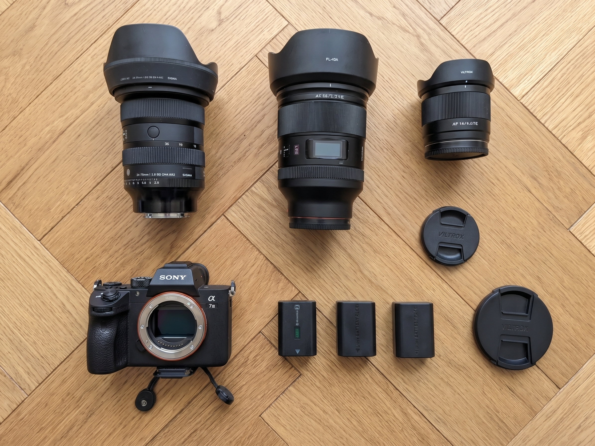

Whenever I head out for a weekend walk, a longer hike in nature, or a city trip, my camera backpack is almost always with me. Over time, my gear has gone through a few changes, mostly through trial and error out on the trail. 

Here is a look at the camera equipment I use in 2026, how my lens lineup evolved, and a few honest lessons I learned along the way.

## What's in My Bag

Before diving into the details, here is the core gear I currently own and pack for my outings:

| Category | Gear | Main Use Case |
| :--- | :--- | :--- |
| Camera Body | Sony A7 III (Full Frame) | Large full frame sensor, great grip, reliable allrounder |
| Main Zoom Lens | Sigma 24-70mm F2.8 | The all in one lens, my go to on almost every hike and tour |
| Fast Prime Lens | Viltrox 35mm F1.2 | Great focal length, extreme low light & bokeh |
| Ultra Wide Lens | Viltrox 14mm F4 | Super fun for architecture and creative wide angle perspectives |
| Accessories | Camera Backpack | Safe carrying on long trails and enough power for multi day trips |

## The Camera Body: Sony A7 III

The heart of my setup is the Sony A7 III, which I have been using for about two years now. Thanks to its shape and deep grip, the body feels great in the hand even when carrying it for hours on a walk. Inside, it packs a large full frame sensor that delivers fantastic image quality, great dynamic range, and reliable low light performance.

One habit I noticed about how I actually shoot on the go: I rarely use the electronic viewfinder (EVF). Almost all the time, I compose my shots directly using the rear screen. For my style of shooting, especially when angling the camera up or down on walks, the built in display is plenty bright and sharp enough to judge focus and exposure accurately without pressing my eye against the viewfinder.

## My Lens Journey: From the Kit Lens to My Current Trio

Like many people getting into photography, my lens collection didn't start out where it is today. Each lens I bought solved a specific problem I ran into while out shooting.

### Starting Out with the Kit Lens
When I first bought the Sony A7 III, I started with the standard kit lens. To be fair, it was totally fine for learning the basics and getting a feel for the camera. However, after a few trips, I quickly realized that I wanted "proper" glass, something sharper, faster, and with a noticeably better look.

### Going Fast (and Heavy): Viltrox 35mm F1.2
My first real upgrade was the Viltrox 35mm F1.2. Optically, it is a fantastic lens, and 35mm is a really great, natural focal length for everyday shooting. That massive F1.2 aperture lets in a ton of light, creates a beautiful blurry background (bokeh), and delivers super sharp images.

The catch? It weighs a hefty 910g. When you are out on a long hike or walking around all day, you really feel that weight in your hands and on your shoulders. And even though 35mm is a great focal length on its own, being locked into a fixed prime meant I often wished I had more flexibility to zoom in or out on a tour without swapping lenses.

### The All in One Lens: Sigma 24-70mm F2.8
Because I wanted maximum flexibility on my tours without sacrificing image quality, I picked up the Sigma 24-70mm F2.8. 

For me, this is simply the all in one lens that is perfect for everything. Today, it stays on my camera most of the time when I'm out on hikes and excursions. Whether I want a wide landscape shot at 24mm, a natural perspective at 35mm or 50mm, or a tighter detail shot at 70mm, I have it all in a single lens. With a constant F2.8 aperture, it is still bright enough for shaded forest trails or evening light, and I am super happy with how versatile it makes my setup.

### Trying Something New: Viltrox 14mm F4
After having my standard range covered, I wanted to experiment with a completely different look and picked up the compact Viltrox 14mm F4. 

Shooting at 14mm on a full frame sensor is a ton of fun. You get an extreme ultra wide field of view that pulls everything into the frame, making it great for architecture and unusual angles, for example tilting the camera straight toward the sky in tight courtyards and streets. If you want to see what kind of shots this perspective makes possible, check out my post [Looking Up in Hamburg](/looking-up-hamburg/), where wide angle views turn everyday buildings into geometric frames.

## Backpack & Power on the Go

Rounding out the setup is a dedicated camera backpack and three batteries in total. 

When hiking, having a proper camera backpack makes a huge difference because everything stays padded, organized, and comfortable on your back over many kilometers. And while the Sony A7 III already has great battery life, carrying three charged batteries means I never have to worry about running out of juice, even on long day trips in colder weather or when using the bright LCD screen all day long.

## What I Learned & Conclusion

Before getting a dedicated camera, I already spent years taking lots of photos with my phone wherever I went. At some point, though, I wanted to dive much deeper into photography and see what was possible beyond a smartphone. When you reach that point and start looking for your first real camera, it is easy to think you immediately need a full frame setup like mine. Looking back at the last two years, however, my biggest takeaway for beginners is that you really don't need an expensive full frame camera to start. 

Full frame bodies and especially full frame lenses are big, heavy, and pricey. If I were recommending a starter setup to a friend today, I would point them straight toward an APS-C camera like the Sony a6700 or Sony a6600 paired with an affordable 50mm prime lens. It is much lighter for hiking and travel, costs a lot less, and still delivers outstanding image quality that is more than enough for almost any situation.

Regardless of which sensor size you choose, making that jump from a phone to a real camera was one of the best decisions for me. Having full manual control out on the trail and editing the RAW files afterward in Adobe Lightroom opened up a whole new creative side. Taking my camera out on walks and trips, trying out new perspectives, and bringing the shots to life in Lightroom is simply a lot of fun, and I couldn't be happier with my current kit.
