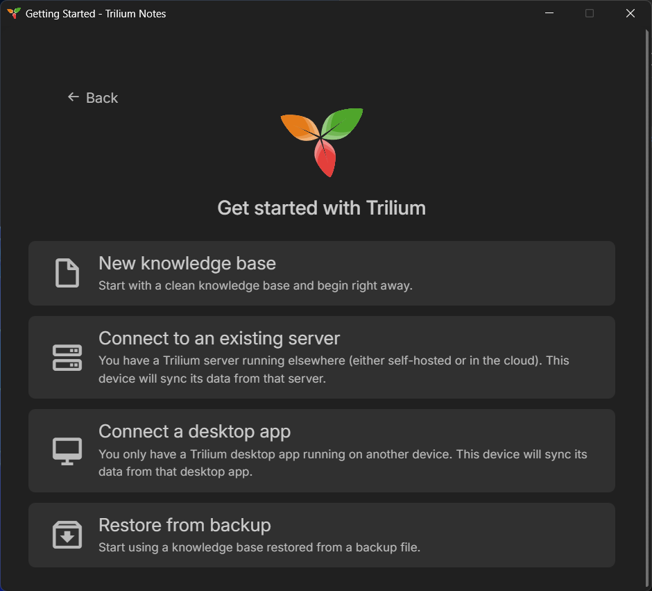

## The Search for the Right Note App

If you are passionate about self-hosting, homelabs, and tech in general, you know the struggle: you try dozens of note-taking tools, document editors, and personal wikis. Some look gorgeous but lock your data behind proprietary clouds. Others store everything as loose text files on disk, which sounds great on paper until your note collection grows into thousands of entries and cross-referencing becomes clunky.

Over a year ago, I decided to give **[Trilium Notes](https://triliumnotes.org/)** a serious shot. Fast-forward to today: it has become one of the most critical applications running on my homelab, open on my desktop every single day. 

Here is my in-depth review after more than twelve months of daily use—covering what makes it unique, how I organize my homelab documentation and daily notes, where it shines, where it still has room for improvement, and how it compares to alternatives like Obsidian.


## What is Trilium Notes?

Trilium Notes (actively maintained and evolved on GitHub by the community as Trilium / TriliumNext) is an open-source, hierarchical note-taking application designed specifically for building large personal knowledge bases.

Unlike conventional note tools that force your notes into rigid folders or purely flat tag clouds, Trilium combines:
- **An arbitrarily deep hierarchical note tree:** Any note can serve as both a document with content and a parent container for sub-notes.
- **Note Cloning (Polyhierarchy):** You can place the exact same note in multiple locations across your tree without duplicating data. Edit it in one place, and it updates everywhere instantly.
- **Note Hoisting:** When working on a complex project, you can "hoist" a specific branch to make it the temporary root of your workspace, hiding all visual clutter from the rest of your tree.
- **Attributes & Dynamic Relations:** Labels, relations, and inherited properties let you query, automate, and structure information dynamically.

Because the project is 100% open source on GitHub, it benefits from steady updates, transparent releases, and an active community that continually refines stability and modern features.


## Under the Hood: Why the Database Backend Matters

Most modern offline note applications rely directly on a folder full of plain markdown files on your hard drive. While that offers plain-text portability, it also comes with severe performance and architectural trade-offs once your vault scales.

Trilium takes a fundamentally different route: **it runs on an internal SQLite database**.

In daily practice, this architectural choice makes a massive difference:
1. **Blazing Fast Performance:** Even with thousands of interconnected notes, search queries, filtering, and navigation happen instantaneously.
2. **True Polyhierarchy & Cloning:** Because notes are database entities rather than physical files on a file system, a note can exist in multiple branches simultaneously without symlinks or duplicating storage.
3. **Integrated Revision History:** Every note keeps a detailed history of revisions over time, making it effortless to roll back accidental edits or see what changed weeks ago.
4. **Rich Metadata & Fast Queries:** Trilium allows you to write custom search queries and smart folders that evaluate note attributes at database speed.


## Deployment & Sync: Homelab Heaven

As someone who loves Docker and runs a homelab, Trilium's deployment options are virtually ideal.

### Docker & Desktop Clients
- **Docker Server:** You can deploy the Trilium server container via Docker Compose in under two minutes. It consumes minimal resources and runs quietly in the background on your home server or VPS.
- **Desktop Apps on Linux and Windows:** Trilium provides native standalone desktop applications for Linux and Windows. I use it across my Linux machines (including CachyOS) and Windows systems without any headaches.


## Step-by-Step: How to Set It Up Yourself with Docker Compose

If you are new to Docker, don't worry: running Trilium this way is surprisingly simple. You don't need to manually install Node.js, databases, or runtime dependencies on your machine. Docker bundles everything Trilium needs into an isolated container that runs cleanly in the background.

Here is the exact setup process from scratch.

**Step 1: Create a Folder for Your Setup**

First, open your terminal and create a dedicated directory where your configuration and notes database will live:

```bash
mkdir -p ~/trilium-server && cd ~/trilium-server
```

**Step 2: Create the `docker-compose.yml` File**

Inside that folder, create a file named `docker-compose.yml`:

```bash
nano docker-compose.yml
```

Paste the following configuration:

```yaml
services:
  trilium:
    image: triliumnext/trilium:latest
    container_name: trilium
    restart: unless-stopped
    ports:
      - "8080:8080"
    volumes:
      # Persistent data stored in a subfolder named 'trilium-data' on your host.
      # This ensures all your notes and the SQLite database survive container restarts & updates.
      - ./trilium-data:/home/node/trilium-data
    environment:
      - TRILIUM_DATA_DIR=/home/node/trilium-data
```

**Step 3: Fire Up the Container**

To start Trilium in the background (detached mode), run:

```bash
docker compose up -d
```

You can verify that everything is running properly by checking the container logs:

```bash
docker compose logs -f
```
*(Press `Ctrl + C` anytime to exit the log view; the container will keep running in the background).*

**Step 4: First-Time Setup in Your Browser**

1. Open your web browser and navigate to:
   ```text
   http://localhost:8080
   ```
   *(Or replace `localhost` with your server's local IP, e.g., `http://192.168.1.100:8080` if running on another device).*
2. On the welcome screen, select **"New knowledge Base"**.
3. Set your admin password. That's it—your personal server is online and ready!




**Step 5: Connecting the Desktop App (Linux / Windows)**

If you prefer working in a dedicated window instead of a browser tab:
1. Download and install the desktop app for Linux or Windows from GitHub.
2. Launch the desktop app. On the initial startup screen, choose **"I am a client of a sync server"** instead of creating a fresh database.
3. Enter your server URL and port (e.g., `http://192.168.1.100:8080`) and your login credentials.
4. Trilium will sync your complete database locally. From that point on, every note you write on desktop syncs to your server automatically.

**Effortless Synchronization (Docker to Docker)**

Syncing in Trilium is built directly into its core rather than bolted on as an afterthought:
- **Desktop to Docker:** Your standalone desktop application syncs bidirectionally with your central Docker instance. Setup is as straightforward as entering your server's URL, port, and your user credentials.
- **Docker to Docker:** What makes Trilium even cooler for homelabbers is that you can sync an entire Docker instance to another Docker instance. For off-site backups, secondary homes, or high-availability setups, you simply configure the target server address and port, and Trilium handles database synchronization reliably.


## How I Use Trilium Every Day

Over the past year, my workspace has grown naturally into a structured system that supports both my daily productivity and my technical projects.

**1. Daynotes (Daily Journaling)**

Trilium has a built-in "Day notes" feature that automatically creates a dated entry for each day. Every morning, I open today's note and jot down:
- What I worked on and tasks accomplished.
- Quick terminal snippets, error logs, and findings.
- Notes from meetings or project milestones.

Having a dedicated journal integrated directly beside my permanent technical notes makes it easy to look back and see exactly when a server change happened or how a bug was resolved.

**2. Homelab & Infrastructure Documentation**

I maintain a dedicated, well-structured folder for all my documentation. Whenever I install a new tool, spin up a Docker container, or adjust network settings, I document it right away:
- Step-by-step setup guides for containers and services.
- Docker Compose files and environment variable references.
- Network layouts, port assignments, and backup routines.

Whenever something breaks months later, I don't have to search forum threads—my exact setup steps and configuration details are right there.

**3. Built-In Kanban Boards**

Instead of running a separate task manager or an external Trello-like board, Trilium provides native Kanban boards. I use them to track:
- Homelab upgrades and server maintenance tasks.
- Project backlogs and active sprints.
- To-dos categorized into "To Do", "In Progress", and "Done".

The beauty of having Kanban boards inside Trilium is context: each card on the board can be linked directly to its corresponding documentation note.

**4. Templates for Consistency**

To keep everything tidy without repetitive typing, I rely heavily on **Templates**:
- **Daynote Template:** Pre-populates daily sections for quick tasks, notes, and accomplishments.
- **Homelab Service Template:** Automatically inserts sections for *Container Details*, *Configuration*, *Backup Procedure*, and *Troubleshooting*.


## Rich Content, Markdown & Visual Power

I am a big fan of Markdown, and Trilium handles text formatting gracefully. It offers rich-text editing with full markdown shorthand support: headers (`#`), bold, lists, and quotes format instantly as you type.

Beyond standard text formatting, Trilium is packed with rich note types out of the box:

- **Syntax-Highlighted Code Blocks:** Clean syntax highlighting for bash, YAML, JSON, Python, and dozens of other languages—essential for homelab documentation.
- **Tables & Internal Links:** Easy inline tables and seamless `@` or `[[` style links and backlinks to other notes.
- **Mindmaps & Mermaid Diagrams:** Built-in rendering for Mermaid charts and interactive mindmaps to visualize workflows and architectures.
- **Spreadsheets:** Integrated lightweight spreadsheets (similar to Excel or Sheets) directly inside a note when simple tables aren't enough.
- **Canvas (Excalidraw Integration):** Built-in hand-drawn style canvas diagrams for sketching network topologies, app flows, or architecture drafts without opening external drawing tools.


## The AI / LLM Experience: Great for Single Notes, Early for Vaults

Trilium supports integration with Large Language Models (LLMs)—both local engines like Ollama and cloud APIs.

```text
[Local LLM / Ollama]  <--->  [Trilium Note Assistant]  <--->  [Active Document]
```

Here is my honest takeaway on the AI features:
- **Where it excels:** Refining, rewriting, summarizing, or formatting an individual note. If you have messy notes from a debugging session and want the LLM to clean them up into a neat step-by-step tutorial, it works wonderfully.
- **Where it currently struggles:** Cross-note awareness. If you ask the AI questions that require understanding relationships between multiple different notes spread across separate folders in your tree, the model still has a hard time gathering the relevant context. For deep "chat-with-your-entire-second-brain" queries, the multi-note RAG context is still in its early stages compared to specialized external tooling.


## The Weak Spot: Mobile Experience

If Trilium has an Achilles' heel, it is the mobile experience. 

Officially, Trilium provides a built-in mobile web view that can be saved as a PWA ("Add to Home Screen"). The community has also built dedicated open-source mobile apps—such as **TriliumDroid** and **Pocket Trilium** on Android, or **Trinote** on iOS. 

While it is great that these mobile options exist, they are noticeably less adapted and polished compared to the desktop version. Navigating an intricate hierarchical tree, editing rich layouts, or managing attributes on a small touchscreen feels clunky and unintuitive. For quickly looking up a command or saving a fleeting thought on the go, they work fine—but Trilium is fundamentally designed to shine on a desktop or laptop.


## Quick Comparison: Trilium vs. Obsidian & Notion

| Feature | Trilium Notes | Obsidian | Notion |
| :--- | :--- | :--- | :--- |
| **Storage** | SQLite Database | Local Markdown Files | Proprietary Cloud |
| **Hosting & Sync** | Self-hosted (Docker, built-in sync) | Local (paid sync or plugins) | Cloud only |
| **Out-of-the-Box** | Kanban, Canvas, Sheets, Diagrams | Requires community plugins | Built-in |
| **Hierarchy** | Deep tree + Note Cloning | Folders + Flat Links | Nested pages |
| **Mobile App** | Web / Community apps (rough) | Polished native app | Polished native app |

- **Vs. Obsidian:** Obsidian is great if you want plain text files on disk and a polished mobile app. But Trilium gives you Kanban, Canvas, Diagrams, note cloning, and effortless server sync out of the box without managing a fragile stack of community plugins.
- **Vs. Notion:** Notion offers slick databases, but locks you into a proprietary cloud. Trilium delivers similar database-driven power and rich note types with complete homelab privacy and data ownership.


## Tips for Getting the Most Out of Trilium

1. **Leverage Note Cloning:** Don't hesitate to clone a note into multiple branches (e.g., keeping a specific Docker guide under both `Homelab / Containers` and `Projects / Home Assistant`). It eliminates the "where should I file this?" dilemma.
2. **Automate with Templates:** Set up a default template for your Daynotes and technical documentations from day one. It guarantees consistent structure.
3. **Use Note Hoisting:** If your tree grows large, hover over your current project folder and hoist it. Your workspace suddenly becomes clean and laser-focused.
4. **Regular Database Backups:** Since everything lives in SQLite, backing up your entire Trilium instance is as simple as copying the data directory or taking an automated snapshot in Docker.


## Conclusion: One Year In, and Here to Stay

After using Trilium Notes every single day for over a year, I can confidently say it has solved my personal knowledge management puzzle. 

It strikes a sweet spot that few other tools manage: it combines the speed, cloning flexibility, and query power of a database with the clean syntax of Markdown and the privacy of self-hosting. From logging my daily work in Daynotes to maintaining exhaustive homelab documentation, Kanban boards, and architecture diagrams, it handles everything seamlessly.

While the mobile interface won't win design awards, its desktop and server experience is rock-solid. If you run a homelab or value privacy, speed, and deep hierarchical organization, Trilium Notes is well worth your time.


## Sources & Documentation

- Official Website: [https://triliumnotes.org/](https://triliumnotes.org/)
- GitHub Repository: [https://github.com/TriliumNext/Trilium](https://github.com/TriliumNext/Trilium)
- Docker Image: [https://hub.docker.com/r/triliumnext/trilium](https://hub.docker.com/r/triliumnext/trilium)
- Official Wiki: [https://github.com/zadam/trilium/wiki](https://github.com/zadam/trilium/wiki)
- Mobile Clients & Community Apps:
  - [https://github.com/FliegendeWurst/TriliumDroid](https://github.com/FliegendeWurst/TriliumDroid)
  - [https://github.com/Nriver/pocket-trilium](https://github.com/Nriver/pocket-trilium)
  - [https://apps.apple.com/app/trinote/id1661603569](https://apps.apple.com/app/trinote/id1661603569)

