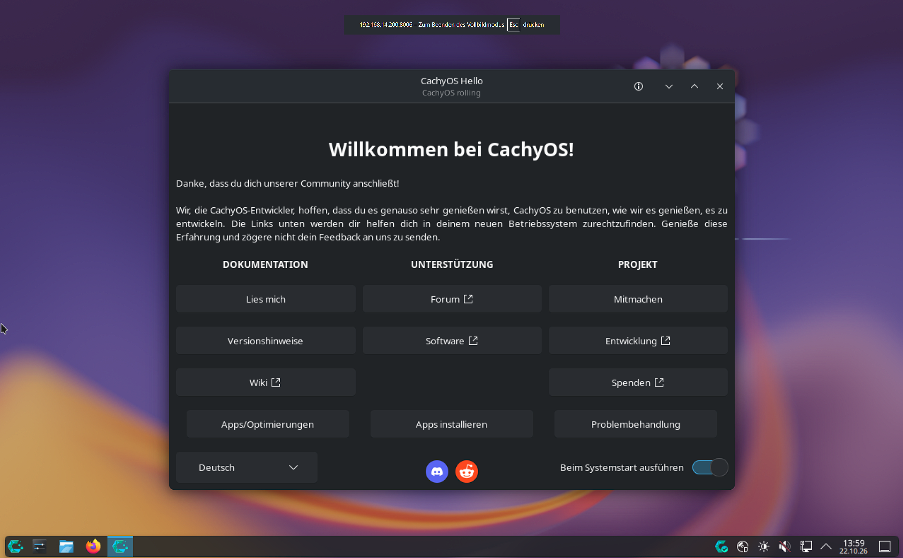

## How I ended up with CachyOS

I've tried quite a few Linux distributions over the years. At some point I wanted something based on Arch Linux that works without much hassle and is built with performance in mind from the start. That's how I ended up with CachyOS.

These days I use CachyOS every day on two devices: my mini PC at home and my laptop when I'm on the go. To get it out of the way: so far I'm very happy with it.


## Installation and first boot

The installation is simple. The graphical installer guides you through the setup step by step. Along the way you can choose which desktop environment you want, for example GNOME, XFCE or Hyprland. The default is KDE Plasma, which is also what I use on both devices.

After the first boot, a welcome window (CachyOS Hello) opens. It puts the most important things in one place: links to the documentation, additional software, gaming packages and a few settings. This is especially handy at the beginning, because you don't have to go looking for anything.



(I set it up in german, so the welcome screen is also in german)


## At home on the mini PC

I mainly use my mini PC for trying things out. I often test AI models and tools like Antigravity, Gemma 4 or ChatGPT to see what they can do and what I can use them for. Since CachyOS ships very up-to-date packages, I can usually install new tools without any workarounds.

I also use the mini PC to learn more about Linux. I try out commands, look at how the system works and sometimes test other desktop environments to compare them with KDE. When I get stuck, I check the Arch Wiki. It's great for looking up commands, and the explanations are usually easy to follow.

Of course, my mini PC isn't as powerful as a proper desktop PC. But it's good enough for some gaming in between. I occasionally play Counter-Strike 2 or Assassin's Creed Mirage, the latter on medium settings. Both run through Steam with Proton without any problems, and I barely notice a difference compared to gaming on Windows.


## On the go with the laptop

On my laptop, two things matter to me: battery life and the fact that it still runs smoothly despite its age. CachyOS handles both well. Programs start quickly, the system doesn't feel sluggish, and the battery lasts a good while on the go.

Since I use KDE Plasma with the same programs on both devices, I don't have to readjust when I switch between them.


## The Cachy kernel

What sets CachyOS apart from other Arch-based distributions is mainly its own kernel. It's optimized for performance and fast response times and is also tuned for gaming. On top of that, there are packages built specifically for modern processors.

In everyday use, I notice this because the system stays smooth even when several things are running at once. I didn't have to configure anything myself, as the optimizations are active right from the start.


## A quick word on shortcuts and the terminal

KDE comes with lots of useful keyboard shortcuts. For example, I often use `Alt + Space` to open KRunner and launch programs, and `Meta + Arrow keys` to snap windows to the edge of the screen. You can also set up your own shortcuts in the system settings.

By default, CachyOS uses the Fish shell, which comes with features like autocompletion. I still switched to Bash, simply because I'm used to it from other distributions.


## What's not so great

CachyOS isn't for everyone. It's based on Arch Linux and follows a rolling release model. That means updates arrive continuously instead of in big versions that have been tested for a long time. You always get current software, but an update can also break something. When that happens, you have to find the cause and fix the problem yourself. If you don't feel like dealing with that and just want a system that runs without much effort, you're probably better off with a different distribution.

The AUR (Arch User Repository) also has two sides. You can find almost any software there, but the packages are uploaded by the community and not officially reviewed. So it can happen that there are malicious or outdated packages in there. That's why you shouldn't just install everything without taking a quick look first.


## Tips for beginners

**Set up snapshots:** For me, this is the most important tip. If you choose the Btrfs file system during installation, you can use tools like Snapper or Timeshift to create backups of your system. If something stops working after an update, you can simply roll back to the previous state.

**Take a closer look at AUR packages:** CachyOS already comes with `paru`, a tool for the AUR. Before installing a package, it's worth checking its page: How many people use it, when was it last updated, and are there any suspicious comments?

```bash
paru -S <package-name>
```

**Use the welcome window:** You can open CachyOS Hello again at any time. It gives you access to lots of settings without having to search for them.

**Check the Arch Wiki:** Whether you're looking for a command or trying to solve a problem, you'll almost always find an answer in the Arch Wiki. I've learned a lot there.


## Conclusion

I now use CachyOS every day and I'm very happy with it so far. On the mini PC I can test AI tools, learn more about Linux and play a bit in between. On the laptop, the system runs smoothly despite the older hardware, and the battery holds up well.

With an Arch-based system you have to take care of things yourself a bit more than with some other distributions. If you're okay with that and keep a few things in mind, like snapshots, you get a fast and flexible system. It works for me, and I currently have no plans to switch.


## Sources & Documentation

- Official Website: [https://cachyos.org/](https://cachyos.org/)
- CachyOS Wiki: [https://wiki.cachyos.org/](https://wiki.cachyos.org/)
- GitHub Repository: [https://github.com/CachyOS](https://github.com/CachyOS)
- Arch Wiki: [https://wiki.archlinux.org/](https://wiki.archlinux.org/)
- Forum & Community: [https://forum.cachyos.org/](https://forum.cachyos.org/)
